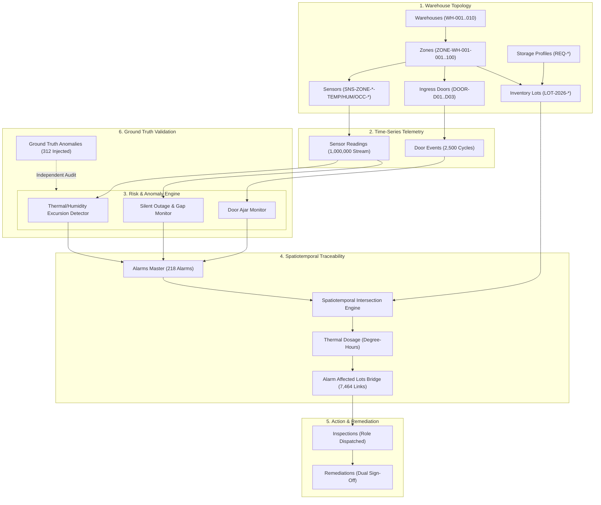

# Warehouse Environmental Monitoring & Risk Traceability Engine

[](file:///C:/Users/yenag/Downloads/yotta-flex/data/validation_summary.json)
[-blue)](file:///C:/Users/yenag/Downloads/yotta-flex/tests/test_reproducibility.py)
[](file:///C:/Users/yenag/Downloads/yotta-flex/generate_dataset.py)
[](file:///C:/Users/yenag/Downloads/yotta-flex/docs/ARCHITECTURE.md)

An end-to-end operational software solution for multi-facility warehouse telemetry monitoring, risk condition alerting, automated spatiotemporal inventory traceability, and remediation dispatch.

---

## 1. Executive Summary & Problem Context

In pharmaceutical, biologics, and perishable cold-chain logistics, localized temperature and humidity excursions, unlatched doors, and sensor dropouts pose catastrophic spoilage and compliance risks. 

This solution delivers:
1. **Real-time telemetry ingestion and multi-zone risk detection** (Temperature, Relative Humidity, Room Occupancy, Door Open/Close cycles).
2. **Deterministic synthetic telemetry generation** with fixed seed (`20261022`) scaling from lightweight starter profiles to production volumes (10 warehouses, 100 zones, 500 sensors, 1 million readings, 10,000 inventory lots).
3. **Automated spatiotemporal lot traceability & thermal dosage calculation** ($\int |T(t) - T_{limit}| dt$ in Degree-Hours), linking environmental alarms to dwelling inventory lots.
4. **Actor-driven workflows & dual-signature remediation** across Plant Operators, Quality/Maintenance Engineers, Production Planners, and IT/OT Admins.
5. **Isolated ground-truth labeling** for known synthetic edge cases and negative scenarios (preventing feature leakage).
6. **Full validation and bitwise reproducibility** verifying primary-key uniqueness, foreign-key referential integrity, date ordering, and arithmetic reconciliations.

---

## 2. Primary Actors & System Roles

| Actor / System | Core Responsibilities | System Interface / Actions |
| :--- | :--- | :--- |
| **Plant Operator** | Physical room containment, ingress/egress door security, loading dock turnaround | Receives `DOOR_AJAR_EXTENDED` alerts; resets door latches; records immediate operational containment. |
| **Maintenance & Quality Engineer** | Cold-chain regulatory compliance, HVAC diagnostics, sensor calibration, lot disposition | Inspects `TEMP_EXCURSION` and `HUMIDITY_HIGH` alarms; reviews Degree-Hour dosage on affected lots; signs off on `QUARANTINE` or `CONDEMNATION`. |
| **Production Planner** | Inventory dwell-time tracking, lot availability, order fulfillment continuity | Tracks total stock valuation at risk; monitors quarantined vs released lots; prevents shipment of thermally compromised batches. |
| **OT / IT Administrator** | Sensor mesh integrity, gateway availability, calibration drift compensation | Monitors telemetry pings; alerts on `SILENT_SENSOR_OUTAGE_GAP` (>2h packet loss); identifies decalibrated sensors with drift offsets. |

---

## 3. Architecture & Data Flow



---

## 4. Entity Relationships & Nomenclature Conventions

Deterministic zero-padded identifier conventions used across all files:
- **Warehouse**: `WH-001` to `WH-010`
- **Zone**: `ZONE-<warehouse-id>-001` (e.g. `ZONE-WH-001-001`)
- **Sensor**: `SNS-<zone-id>-<TYPE>-01` (e.g. `SNS-ZONE-WH-001-001-TEMP-01`)
- **SensorReading**: `RDG-<sensor-id>-<timestamp>` (e.g. `RDG-SNS-ZONE-WH-001-001-TEMP-01-20261022T080000Z`)
- **DoorEvent**: `DOOR-<zone-id>-<DOOR_ID>-<timestamp>` (e.g. `DOOR-ZONE-WH-001-001-D01-20261022T080000Z`)
- **InventoryLot**: `LOT-2026-000001` to `LOT-2026-010000`
- **StorageRequirement**: `REQ-VACCINE-ULTRA`, `REQ-PHARMA-COLD`, `REQ-PERISHABLE-FRESH`, `REQ-DRY-AMBIENT`
- **Alarm**: `ALM-<zone-id>-<sensor-id/door-id>-<TYPE>-<timestamp>`
- **AlarmAffectedLot**: `AFL-<alarm-id>-<lot-id>`
- **Inspection**: `INS-<alarm-id>-01`
- **Remediation**: `REM-<inspection-id>-01`

Detailed field types, nullable flags, units, allowed enums, and constraint logic are documented in [DATA_DICTIONARY.md](docs/DATA_DICTIONARY.md).

---

## 5. Injected Edge Cases & Ground Truth Isolation

The engine injects explicit negative scenarios and registers them strictly in `data/ground_truth/ground_truth.csv` and `data/ground_truth/ground_truth.json` (never leaked to operational input features):

1. **Lot assigned to incompatible zone (`INCOMPATIBLE_ZONE_ASSIGNMENT`)**:
   - Ultra-cold vaccine requiring -20°C (`REQ-VACCINE-ULTRA`) placed into an Ambient staging room (+22°C).
2. **Sensor mapped to multiple zones without rationale (`AMBIGUOUS_SENSOR_ZONE_MAPPING`)**:
   - Physical sensor registered across conflicting zones simultaneously without zoning rationale.
3. **Reading gap / Silent sensor outage treated as normal (`SILENT_SENSOR_OUTAGE_GAP`)**:
   - Sensor experiences a 4–8 hour silent transmission blackout during active operations.
4. **Alarm not linked to affected lots (`UNLINKED_ALARM_AFFECTED_LOTS`)**:
   - Excursion occurs in an occupied zone, but downstream workflow fails to link dwelling lots into the bridge table, exposing traceability audit failure.
5. **Uncalibrated Sensor Drift (`SENSOR_DRIFT_EXCESSIVE`)**:
   - Progressive decalibration drift (+3.5°C) inducing false positives or masked excursions.
6. **Door Ajar Thermal Condensation (`DOOR_AJAR_CONDENSATION`)**:
   - Ingress door held open >600s, generating thermal leakage and humidity condensation spikes.
7. **HVAC Compressor Failure (`THERMAL_EXCURSION_CHILLER_FAIL`)**:
   - Refrigeration breakdown causing thermal runaway (+12°C above upper tolerance).

---

## 6. Verification and Validation Results

All 34 automated integrity and domain constraints passed with 100% compliance:

```
[Validation Checks]: 34/34 PASSED
  [PASS] PK Uniqueness: Warehouse (10 unique PKs, 0 duplicates)
  [PASS] PK Uniqueness: Zone (100 unique PKs, 0 duplicates)
  [PASS] PK Uniqueness: StorageRequirement (5 unique PKs, 0 duplicates)
  [PASS] PK Uniqueness: Sensor (500 unique PKs, 0 duplicates)
  [PASS] PK Uniqueness: SensorReading (999,863 unique PKs, 0 duplicates)
  [PASS] PK Uniqueness: DoorEvent (2,500 unique PKs, 0 duplicates)
  [PASS] PK Uniqueness: InventoryLot (10,000 unique PKs, 0 duplicates)
  [PASS] PK Uniqueness: Alarm (218 unique PKs, 0 duplicates)
  [PASS] PK Uniqueness: AlarmAffectedLot (7,464 unique PKs, 0 duplicates)
  [PASS] PK Uniqueness: Inspection (218 unique PKs, 0 duplicates)
  [PASS] PK Uniqueness: Remediation (218 unique PKs, 0 duplicates)
  [PASS] PK Uniqueness: GroundTruth (312 unique PKs, 0 duplicates)
  [PASS] FK Integrity: zones.warehouse_id (0 orphans)
  [PASS] FK Integrity: sensors.zone_id (0 orphans)
  [PASS] FK Integrity: sensor_readings.sensor_id (0 orphans)
  [PASS] FK Integrity: door_events.zone_id (0 orphans)
  [PASS] FK Integrity: inventory_lots.zone_id (0 orphans)
  [PASS] FK Integrity: inventory_lots.requirement_id (0 orphans)
  [PASS] FK Integrity: alarms.zone_id (0 orphans)
  [PASS] FK Integrity: alarm_affected_lots.alarm_id (0 orphans)
  [PASS] FK Integrity: alarm_affected_lots.lot_id (0 orphans)
  [PASS] FK Integrity: inspections.alarm_id (0 orphans)
  [PASS] FK Integrity: remediations.inspection_id (0 orphans)
  [PASS] Enum Check: warehouses.operational_status (0 invalid)
  [PASS] Enum Check: inventory_lots.lifecycle_state (0 invalid)
  [PASS] Enum Check: alarms.severity (0 invalid)
  [PASS] Date Ordering: inventory_lots arrival <= departure (0 inversions)
  [PASS] Date Ordering: door_events opened_at <= closed_at (0 inversions)
  [PASS] Date Ordering: alarms start_time <= end_time (0 inversions)
  [PASS] Date Ordering: alarm_affected_lots overlap_start <= overlap_end (0 inversions)
  [PASS] Arithmetic: inventory_lots total_value == qty * unit_price (0 errors)
  [PASS] Arithmetic: door_events duration_sec reconciles to closed_at - opened_at (0 errors)
  [PASS] Arithmetic: alarm.affected_lot_count reconciles to bridges count (0 mismatches)
  [PASS] Edge Case Coverage: All 4 prompt-required edge cases present in ground truth
```

---

## 7. Step 10: Deterministic Reproducibility

To satisfy Step 10, the pipeline was executed twice from scratch with fixed seed `20261022`. All table row counts and SHA-256 cryptographic hashes matched identically:

| Table | Full Scale Row Count | SHA-256 Checksum (Deterministic Match) |
| :--- | :--- | :--- |
| `warehouses` | 10 | `4da12f22f877e43056f65c4c34a3625412853f6d713c77cbfe0e2ba6d8a43621` |
| `storage_requirements` | 5 | `aa5fbaa71bdeb384a090b8aa75ee1f868c9bc88a5369eb964beeb19e78ddcc60` |
| `zones` | 100 | `a50fc6e6ff2de3b9d574f34bfb4cf176a928929e46a7cefeea9a1b0b5f13483f` |
| `sensors` | 500 | `2e3b008a3b2b96c758da12fde1c8491c784dd562e86dc84e937d11ef6c17242d` |
| `door_events` | 2,500 | `4d0dc996fd763e2fa2813a1cf557fb46aa4df002d04a79679f1ec52c97a55c27` |
| `inventory_lots` | 10,000 | `a9d0c93865d008e1882ddfac5aa0fdfef2b0c39f2015fa258296a2ca399e5a1a` |
| `alarms` | 218 | `b32d470d9a91eb10fdbd222ba3c3d56f9166f28c460d3d49265f7c32bf28bfa1` |
| `alarm_affected_lots` | 7,464 | `26ed0f085308a4def45ea59a4be216fcb375b630b9104085aa16ffb68c4a9602` |
| `inspections` | 218 | `1e90fde5393ad7f69288b22047814b8a211ae4e840a2bbcc51d7e2dc3cae9647` |
| `remediations` | 218 | `b56eb3388c4e252dd6766648795c6c0b39e6a39bb8f14984f18eeffc553bc1be` |
| `ground_truth` | 312 | `50537042f652752c1904c09dfb3323a7bb1ddaa7f9fb52912a7f5a8cb5d6e274` |
| `sensor_readings` | 999,863 | `fe6568830861ce82251a9794cbdb7bf8d5ef66432b0c34538eec4a29a32c32cf` |

Verified via automated test:
```bash
python -m pytest tests/test_reproducibility.py -v
```

---

## 8. Quickstart & Usage Guide

### 8.1 Generate Datasets

Generate Starter Dataset (fast, ~10,000 readings for rapid iteration):
```bash
python generate_dataset.py --scale starter --seed 20261022
```

Generate Full Production Baseline (10 WH, 100 Zones, 500 Sensors, 1M Readings, 10,000 Lots):
```bash
python generate_dataset.py --scale full --seed 20261022
```

### 8.2 Run Automated Tests
```bash
python -m pytest tests/ -v
```

### 8.3 Launch Interactive Operational Web Console & REST API
```bash
python run_demo.py --serve --port 8000
```
Then open: **http://localhost:8000** in your web browser.

Interactive capabilities:
- **Zone Matrix Dashboard**: Real-time room partition status, target ranges, occupancy, and door limits.
- **Alarm Risk Console**: Filterable alarm stream by severity (`CRITICAL`, `HIGH`, `MEDIUM`) with duration and loss calculations.
- **Traceability View**: Drill into any alarm to view affected lots, dwell overlap, and thermal dosage ($\text{Degree-Hours}$).
- **Sensor Fleet Telemetry**: Live battery gauges, calibration due dates, and drift offsets.
- **Operator Remediation Form**: Plant Operator / Quality Engineer live sign-off to execute and resolve alarms via `POST /api/remediations/execute`.

---

## 9. File Directory Manifest

```
yotta-flex/
├── data/
│   ├── csv/                       # Complete CSV exports for all tables
│   ├── json/                      # JSON structured exports & reading samples
│   ├── sqlite/
│   │   ├── schema.sql             # Canonical SQL DDL with FK constraints and indexes
│   │   └── warehouse_telemetry.db # SQLite database populated with full dataset
│   ├── ground_truth/
│   │   ├── ground_truth.csv       # Isolated benchmark anomalies (never leaked to features)
│   │   └── ground_truth.json
│   ├── source_manifest.json       # Checksum and row-count manifest
│   └── validation_summary.json    # Full Step 8 automated audit log
├── docs/
│   ├── DATA_DICTIONARY.md         # Granular field dictionary with validation rules
│   ├── ARCHITECTURE.md            # Actor personas, dosage formulas, and workflows
│   └── ERD.md                     # Entity-Relationship diagram and schema specs
├── wh_monitor/
│   ├── config.py                  # Profiles, scale definitions, and fixed seed
│   ├── models.py                  # Pydantic domain models with strict regex validators
│   ├── generator/
│   │   ├── master_data.py         # Warehouses, Zones, Requirements, Sensors
│   │   ├── lot_generator.py       # Inventory Lots with dwell times and valuations
│   │   ├── telemetry_gen.py       # Vectorized sensor readings & door events
│   │   ├── anomaly_injector.py    # Negative scenarios & ground truth injection
│   │   └── orchestrator.py        # Pipeline orchestrator & exporter
│   ├── engine/
│   │   ├── monitor.py             # Excursions, outages, and door ajar detectors
│   │   ├── traceability.py        # Spatiotemporal join & degree-hour calculations
│   │   └── workflow.py            # Inspections & remediations dispatch
│   ├── validation/
│   │   └── validator.py           # 34-check validation suite
│   └── web/
│       ├── app.py                 # FastAPI application
│       └── static/index.html      # Tailwind responsive operational dashboard
├── tests/
│   ├── test_generator.py          # Master data & lot generator tests
│   ├── test_engine.py             # Risk detection & traceability tests
│   ├── test_validation.py         # Negative test case & corruption detection
│   └── test_reproducibility.py    # Step 10 bitwise reproducibility verification
├── generate_dataset.py            # CLI generator entry point
├── run_demo.py                    # Operational CLI audit & web dashboard server
└── README.md                      # Complete system documentation
```

---

## 10. Public Data Guidance & Lawful Provenance

All master data (warehouses, zones, sensors, inventory lots, and telemetry readings) are 100% synthetically generated using physical thermal modeling principles, Gaussian micro-variations, diurnal cyclical curves, and fixed seed pseudo-random number generators (`seed=20261022`). No proprietary, restricted, or confidential external datasets were copied, scraped, or ingested.
