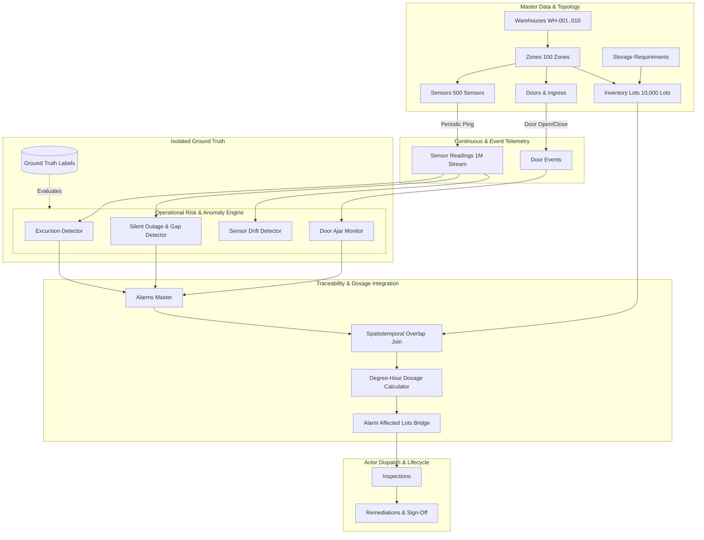

# System Architecture: Warehouse Environmental Telemetry & Risk Traceability

## 1. Architectural Overview

The Warehouse Environmental Monitoring and Risk Traceability System is an end-to-end operational platform engineered for multi-zone cold-chain and pharmaceutical logistics facilities. It monitors continuous telemetry (temperature, humidity, occupancy) and discrete ingress/egress door events across partitioned warehouse zones, detects anomalous risk conditions, determines inventory lot exposure via spatiotemporal join analysis, and orchestrates remediation workflows.

---

## 2. Primary Actors & Operational Workflows

### 2.1 Plant Operator
- **Operational Focus:** Physical door security, dock loading turnaround, immediate ajar warning response.
- **Workflow:** 
  1. Receives `DOOR_AJAR_EXTENDED` warning when door open duration exceeds zone limit (e.g., >60 seconds for cryo vault).
  2. Inspects physical door seal and latch mechanism.
  3. Verifies clearance and resets door latch, recording an operational remediation.

### 2.2 Maintenance / Quality Engineer
- **Operational Focus:** Thermal excursions, humidity spikes, cold-chain compliance, product disposition.
- **Workflow:**
  1. Alerted when calibrated sensor values breach warning or critical thresholds.
  2. Inspects the automated spatiotemporal link showing dwelling lots in the affected zone.
  3. Reviews calculated **Thermal Degree-Hours** ($\int |T(t) - T_{limit}| dt$) and exposure duration against the product's regulatory storage profile (`StorageRequirement`).
  4. Signs off on lot disposition (`QUARANTINED`, `CONDEMNED`, or `RELEASED_WITH_VARIANCE`).

### 2.3 Production Planner
- **Operational Focus:** Lot dwell-time tracking, stock availability, financial value at risk.
- **Workflow:**
  1. Monitors active inventory valuations across zones.
  2. Tracks quarantined stock vs available stock to prevent shipping contaminated or compromised pharmaceuticals.
  3. Adjusts fulfillment routes based on excursion loss reports.

### 2.4 OT / IT Administrator
- **Operational Focus:** Sensor mesh health, telemetry packet rate, battery status, calibration drift.
- **Workflow:**
  1. Monitors heartbeat intervals across all 500 sensors.
  2. Detects `SILENT_SENSOR_OUTAGE_GAP` alarms where a sensor stops publishing for >2 hours.
  3. Identifies sensors with systematic drift offsets and schedules hardware recalibration.

---

## 3. Mathematical & Algorithmic Formulations

### 3.1 Spatiotemporal Lot Overlap Join
Given an alarm $A$ occurring in zone $Z$ over time interval $[t_{A, start}, t_{A, end}]$ and an inventory lot $L$ stored in zone $Z$ with arrival $t_{L, arr}$ and departure $t_{L, dep}$:

$$\text{Overlap Window } [T_{start}, T_{end}] = [\max(t_{A, start}, t_{L, arr}), \min(t_{A, end}, t_{L, dep})]$$

$$\text{Exposure Duration (hours)} = \frac{T_{end} - T_{start}}{3600}$$

If $T_{end} > T_{start}$, lot $L$ is flagged as exposed, generating a record in `AlarmAffectedLot`.

### 3.2 Thermal Dosage (Degree-Hours)
To quantify cumulative thermal abuse beyond simple duration:

$$\text{Degree-Hours } (^{\circ}\text{C}\cdot\text{h}) = \int_{T_{start}}^{T_{end}} \max\left(0, T(t) - T_{limit}\right) dt$$

Where:
- $T(t)$ is calibrated temperature at time $t$.
- $T_{limit}$ is upper or lower critical limit defined in `StorageRequirement`.

---

## 4. Ground Truth Isolation Strategy

To ensure scientific integrity and eliminate data leakage:
1. Ground truth records (`ground_truth.csv` and `ground_truth.json`) are stored strictly outside operational feature inputs.
2. The operational detection engine queries only raw/calibrated telemetry streams, door logs, and topology tables.
3. Model evaluation benchmarks compare the engine's detected alarms against ground truth labels using precision, recall, and Mean Time to Detect (MTTD).
