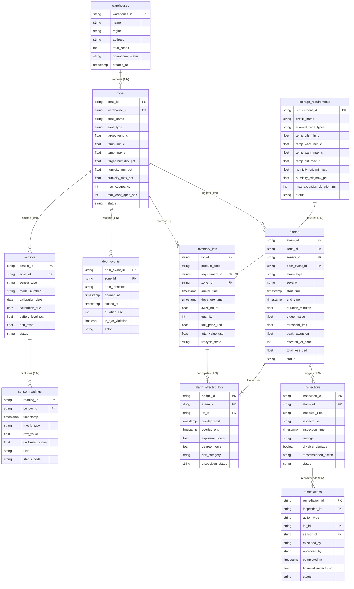

# Entity-Relationship Diagram (ERD) & Schema Specification

This document details the entity relationships, keys, cardinalities, and bridge tables for the Warehouse Environmental Monitoring & Risk Traceability System.

---

## 1. Visual Entity-Relationship Diagram

---

## 2. Cardinalities and Relational Rules

1. **Warehouse to Zone (1:N)**:
   - A Warehouse contains 1 to 50 Zones. Each Zone belongs to exactly one parent Warehouse.
   - Deleting a Warehouse cascades to its Zones.
2. **Zone to Sensor (1:N)**:
   - Each Zone contains multiple environmental sensors (minimum 3: Temperature, Humidity, Occupancy).
   - Each Sensor belongs to exactly one primary Zone.
3. **Sensor to SensorReading (1:N)**:
   - Continuous time-series stream where one sensor emits thousands of observations over time.
4. **Zone to DoorEvent (1:N)**:
   - A Zone records all door open/close cycles for its physical ingress/egress doors.
5. **StorageRequirement to InventoryLot (1:N)**:
   - Standard regulatory specification applied to multiple inventory lots of matching product codes.
6. **Zone to InventoryLot (1:N)**:
   - An InventoryLot dwells in a specific storage zone for a duration between arrival and departure.
7. **Alarm to InventoryLot (N:M via `alarm_affected_lots`)**:
   - An Alarm can impact multiple lots dwelling in the zone during the alarm time window.
   - An InventoryLot can experience multiple alarms across its dwell lifetime.
   - Resolved via the `alarm_affected_lots` bridge table containing calculated spatiotemporal intersection intervals and cumulative **Degree-Hours**.
8. **Alarm to Inspection (1:N)**:
   - High and Critical alarms trigger mandatory inspection records assigned to specific roles (Plant Operator, Maintenance Engineer, Quality Engineer).
9. **Inspection to Remediation (1:N)**:
   - Corrective actions recommended by an inspection are executed and approved via dual-sign-off remediation records.
